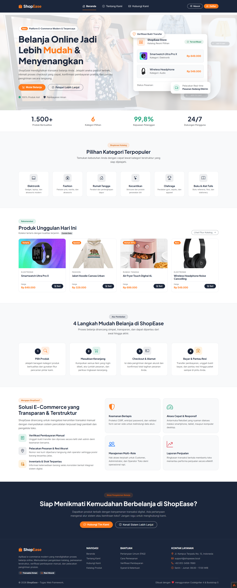
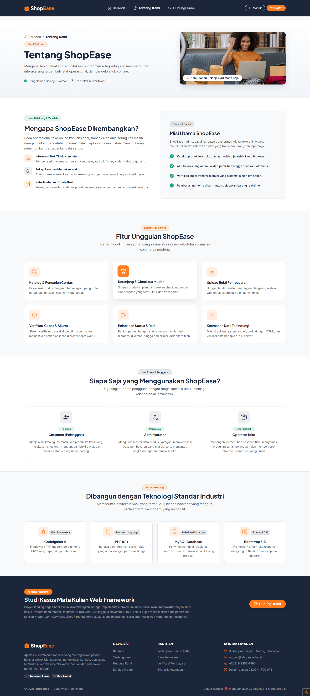
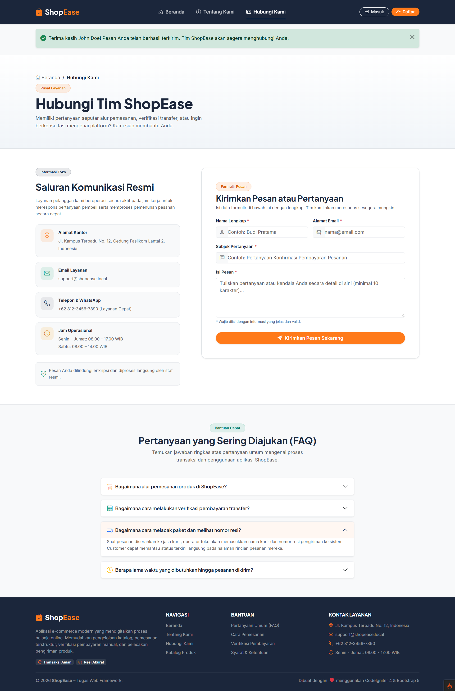

# Laporan Tugas: Landing Page ShopEase

| | |
|---|---|
| **Nama** | Jorell Ramos Sinaga |
| **NRP** | 5025241202 |
| **Mata Kuliah** | Pemrograman Berbasis Kerangka Kerja |
| **Kelas** | D |

---

## Daftar Isi
1. [Pendahuluan](#1-pendahuluan)
2. [Ringkasan yang Dikerjakan](#2-ringkasan-yang-dikerjakan)
3. [Teknologi & Prasyarat](#3-teknologi--prasyarat)
4. [Langkah Pembuatan](#4-langkah-pembuatan)
5. [Penjelasan Kode Penting](#5-penjelasan-kode-penting)
6. [Cara Menjalankan Proyek](#6-cara-menjalankan-proyek)
7. [Hasil Tampilan & Pengujian (Screenshot)](#7-hasil-tampilan--pengujian-screenshot)
8. [Kendala & Solusi](#8-kendala--solusi)
9. [Kesimpulan](#9-kesimpulan)
10. [Referensi](#10-referensi)

---

## 1. Pendahuluan

### 1.1 Latar Belakang
Pada operasional toko online konvensional, transaksi belanja sering kali masih mengandalkan pencatatan manual melalui aplikasi pesan instan atau spreadsheet terpisah. Hal ini kerap menimbulkan ketidakkonsistenan informasi stok produk, kendala rekap transaksi pembayaran yang lambat, serta keterlambatan pembaruan nomor resi kepada pembeli.

Aplikasi **ShopEase – Online Store** dirancang untuk mendigitalkan seluruh alur penjualan toko daring. Mulai dari penjelajahan katalog produk, keranjang belanja, proses checkout, verifikasi bukti pembayaran transfer secara manual oleh administrator, hingga pembaruan nomor resi dan pelacakan pengiriman secara berkala.

### 1.2 Tujuan Tugas
Tujuan dari pengerjaan tugas ini adalah merancang dan mengimplementasikan antarmuka halaman penawaran utama (*Landing Page*) untuk aplikasi e-commerce ShopEase menggunakan **CodeIgniter 4** dengan arsitektur **Model-View-Controller (MVC)**. Tugas ini memfokuskan pada penguasaan konfigurasi routing, pembagian tanggung jawab controller, sistem templating view modern, serta integrasi formulir dan validasi server-side.

### 1.3 Lingkup Pengerjaan
Lingkup tugas landing page ini mencakup 3 halaman utama:
* **Beranda (`/`)**: Menampilkan showcase hero, statistik pencapaian, kategori produk, kartu rekomendasi produk unggulan, alur belanja 4 langkah, keunggulan platform, dan ajakan bertindak (CTA).
* **Tentang Kami (`/about`)**: Menjelaskan latar belakang masalah, tujuan produk, 6 fitur inti sistem, 3 peran pengguna (*Customer, Administrator, Operator Toko*), dan stack teknologi.
* **Hubungi Kami (`/contact`)**: Menyediakan saluran informasi kontak resmi, formulir pengiriman pesan dengan validasi di server (*server-side validation*) dan proteksi CSRF, serta accordion FAQ.

*(Catatan: Sesuai dengan batasan tugas, sistem tidak menggunakan database fisik; data kategori, produk, dan fitur dikelola melalui array terstruktur di controller, dan formulir tidak menyimpan pesan ke basis data melainkan menampilkan flash notifikasi validasi).*

---

## 2. Ringkasan yang Dikerjakan

### 2.1 Tabel Berkas yang Dibuat dan Diubah

| Berkas | Fungsi |
|---|---|
| `app/Config/Routes.php` | Mendefinisikan pemetaan rute URL eksplisit (`/`, `/about`, `/contact`, `/contact/send`) dengan penamaan rute. |
| `app/Config/Filters.php` | Mengaktifkan filter keamanan bawaan `csrf` pada `$globals['before']` untuk perlindungan request POST. |
| `app/Controllers/HomeController.php` | Menangani logika halaman Beranda, menyiapkan contoh data dummy kategori dan produk unggulan. |
| `app/Controllers/AboutController.php` | Menangani logika halaman Tentang Kami, menyiapkan data fitur sistem, peran pengguna, dan teknologi. |
| `app/Controllers/ContactController.php` | Menampilkan formulir kontak dan memproses validasi aturan masukan form pada method `send()`. |
| `app/Views/layouts/main.php` | Kerangka induk layout HTML5 (CDN Bootstrap, Google Fonts, navbar, flash message, slot konten, dan footer). |
| `app/Views/partials/navbar.php` | Komponen navigasi atas responsif (*sticky-top*, logo brand, tombol aksi, dan deteksi menu aktif). |
| `app/Views/partials/footer.php` | Komponen kaki halaman (*dark navy theme*, profil singkat, tautan navigasi, bantuan, dan hak cipta). |
| `app/Views/partials/flash.php` | Komponen pemanggil pesan kilat (*flash message*) sukses dan daftar error form. |
| `app/Views/pages/home.php` | Tampilan konten Beranda lengkap dengan 7 bagian konten. |
| `app/Views/pages/about.php` | Tampilan konten Tentang Kami dengan kartu showcase gambar dan penjelasan modul PRD. |
| `app/Views/pages/contact.php` | Tampilan formulir pesan dengan feedback validasi per kolom input dan accordion FAQ. |
| `public/assets/css/style.css` | Berkas gaya kustom (palet warna ShopEase, tipografi Plus Jakarta Sans & Inter, animasi, dan kartu produk). |
| `.gitignore` | Mengatur berkas dan direktori yang diabaikan dalam version control Git. |

### 2.2 Daftar Halaman dan URL

| Halaman | URL | HTTP Method | Route Name | Keterangan |
|---|---|---|---|---|
| Beranda | `http://localhost:8080/` | `GET` | `home` | Halaman landing page utama |
| Tentang Kami | `http://localhost:8080/about` | `GET` | `about` | Profil sistem, fitur, peran, dan teknologi |
| Kontak | `http://localhost:8080/contact` | `GET` | `contact` | Formulir pesan bantuan dan FAQ |
| Proses Kontak | `http://localhost:8080/contact/send` | `POST` | `contact.send` | Endpoint pemrosesan validasi form |

---

## 3. Teknologi & Prasyarat

* **Framework**: CodeIgniter 4 (instalasi mandiri/arsip ZIP)
* **Bahasa Pemrograman**: PHP versi 8.1 atau lebih tinggi
* **Web Server**: Apache / PHP Development Server bawaan (`php spark serve`)
* **Styling & Ikon**: 
  * Bootstrap v5.3.3 (via CDN jsDelivr)
  * Bootstrap Icons v1.11.3 (via CDN jsDelivr)
  * Google Fonts (*Plus Jakarta Sans* untuk headings, *Inter* untuk body copy)
* **Lingkungan Pengembangan**: Visual Studio Code / Text Editor pilihan, Browser Google Chrome / Mozilla Firefox

---

## 4. Langkah Pembuatan

### Langkah 1: Ekstrak CodeIgniter 4 dan Konfigurasi Lingkungan (`.env`)
1. Ekstrak arsip rilis CodeIgniter 4 ke dalam folder server lokal (misalnya `C:\xampp\htdocs\ShopEase`).
2. Duplikat atau ubah nama berkas konfigurasi template `env` menjadi `.env`.
3. Buka `.env` dan aktifkan mode pengembangan serta base URL lokal:
   ```ini
   CI_ENVIRONMENT = development
   app.baseURL = 'http://localhost:8080/'
   ```

### Langkah 2: Menjalankan Server Pengembangan
Jalankan development server internal CodeIgniter melalui command prompt atau terminal proyek:
```bash
php spark serve
```
Server aktif dan dapat diakses melalui peramban web pada alamat `http://localhost:8080`.

### Langkah 3: Mendefinisikan Rute Eksplisit (`app/Config/Routes.php`)
Buka `app/Config/Routes.php`, lalu definisikan rute secara terstruktur menggunakan penamaan rute (*named routes*):
```php
$routes->get('/', 'HomeController::index', ['as' => 'home']);
$routes->get('/about', 'AboutController::index', ['as' => 'about']);
$routes->get('/contact', 'ContactController::index', ['as' => 'contact']);
$routes->post('/contact/send', 'ContactController::send', ['as' => 'contact.send']);
```

### Langkah 4: Membuat Tiga Controller Terpisah
Buat berkas controller pada direktori `app/Controllers/`:
1. `HomeController.php`: Menyiapkan array dummy kategori dan produk unggulan.
2. `AboutController.php`: Menyiapkan array dummy fitur, pengguna, dan tech stack.
3. `ContactController.php`: Menampilkan antarmuka form dan menangani validasi method `send()`.

### Langkah 5: Membuat Layout Induk dan Partials
Buat struktur berkas layout pada `app/Views/`:
1. `layouts/main.php`: Menjadi kerangka dasar HTML yang memuat Google Fonts, Bootstrap CDN, stylesheet kustom, serta memanggil partials navbar, flash, dan footer.
2. `partials/navbar.php`: Berisi navigasi sticky dan pengecekan menu aktif berdasarkan variabel `$active`.
3. `partials/footer.php`: Berisi identitas brand, tautan cepat, dan informasi copyright.
4. `partials/flash.php`: Menampilkan komponen Bootstrap Alert jika terdapat notifikasi session sukses/gagal.

### Langkah 6: Membuat View Masing-Masing Halaman
Setiap view halaman memanfaatkan fitur pewarisan layout:
```php
<?= $this->extend('layouts/main') ?>

<?= $this->section('content') ?>
    <!-- Konten spesifik halaman di sini -->
<?= $this->endSection() ?>
```
* `pages/home.php`: Disusun dalam 7 section konten (Hero, Stats, Kategori, Produk, Cara Belanja, Keunggulan, CTA).
* `pages/about.php`: Dilengkapi foto showcase belanja digital dan kartu penjelasan fitur PRD.
* `pages/contact.php`: Formulir dua kolom dengan input-group dan accordion FAQ interaktif.

### Langkah 7: Merancang Desain CSS Kustom dan Responsivitas
Berkas `public/assets/css/style.css` dibuat untuk menerapkan palet identitas ShopEase:
* Navy (`#1B263B`): Warna navbar, footer, dan tipografi judul.
* Oranye (`#FF7A1A`): Warna aksen utama tombol ajakan bertindak (CTA) dan sorotan visual.
* Hijau (`#1FA37A`): Warna penanda status positif dan verifikasi.
* Penambahan utilitas kartu `.se-card`, efek melayang `.floating-badge`, serta integrasi foto latar hero `.hero-section-with-bg`.

### Langkah 8: Mengimplementasikan Formulir Kontak dan Validasi Server
Pada `ContactController::send`, aturan validasi dideklarasikan secara ketat dengan pesan bahasa Indonesia:
```php
$rules = [
    'nama'   => 'required|min_length[3]',
    'email'  => 'required|valid_email',
    'subjek' => 'required|min_length[3]',
    'pesan'  => 'required|min_length[10]',
];
```
Jika gagal, pengguna dikembalikan ke halaman form bersama nilai input sebelumnya via `withInput()` dan kumpulan pesan error via `with('errors', ...)`.

---

## 5. Penjelasan Kode Penting

### 5.1 Routing (`app/Config/Routes.php`)
CodeIgniter 4 secara default menonaktifkan auto-routing untuk alasan performa dan keamanan. Setiap URI yang dapat diakses harus dipetakan secara eksplisit:
* Parameter `['as' => 'nama_rute']` memungkinkan pemanggilan URL di sisi View secara dinamis menggunakan helper `url_to('nama_rute')`. Jika sewaktu-waktu struktur URL berubah, tautan di seluruh view akan otomatis menyesuaikan tanpa perlu diubah satu per satu.
* Pemisahan method HTTP `get` (untuk menampilkan laman) dan `post` (untuk memproses pengiriman data form) menjamin alur komunikasi RESTful yang aman.

### 5.2 Controller & Pengiriman Data ke View
Setiap controller mewarisi `BaseController` dan bertugas menyiapkan data lalu merendernya ke view:
```php
$data = [
    'title'            => 'Beranda',
    'active'           => 'home',
    'categories'       => $categories,
    'featuredProducts' => $featuredProducts,
];
return view('pages/home', $data);
```
Data di atas diekstrak secara otomatis oleh engine CodeIgniter sehingga di dalam view variabel dapat langsung dipanggil sebagai `$title`, `$active`, `$categories`, dan `$featuredProducts`.

### 5.3 Sistem Layout Inheritance (`extend` dan `section`)
Penerapan arsitektur view modern menggunakan `layouts/main.php` menghindari pengulangan kode header dan footer:
* `<?= $this->extend('layouts/main') ?>`: Menginstruksikan view untuk menggunakan layout induk.
* `<?= $this->section('content') ?>` ... `<?= $this->endSection() ?>`: Membungkus konten spesifik tiap laman untuk disuntikkan ke dalam `<?= $this->renderSection('content') ?>` milik layout induk.
* `<?= $this->include('partials/nama_partial') ?>`: Memisahkan komponen reusable (navbar, footer, flash message) agar kode tetap modular.

### 5.4 Penanda Menu Aktif pada Navigasi
Indikator menu yang sedang aktif ditentukan lewat perbandingan nilai `$active`:
```php
<a class="nav-link <?= (isset($active) && $active === 'home') ? 'active fw-semibold' : '' ?>" href="<?= url_to('home') ?>">
```
Saat controller mengirim `'active' => 'home'`, link Beranda akan mendapat kelas CSS `.active` yang menambahkan garis aksen oranye di bawah teks menu.

### 5.5 Looping Data Dummy, Sanitasi `esc()`, dan Format Rupiah
Untuk menampilkan daftar produk secara dinamis di view:
```php
<?php foreach ($featuredProducts as $prod): ?>
    <h6 class="fw-bold"><?= esc($prod['name']) ?></h6>
    <span><?= 'Rp ' . number_format($prod['price'], 0, ',', '.') ?></span>
<?php endforeach; ?>
```
* Fungsi `esc()` mencegah celah keamanan Cross-Site Scripting (XSS) dengan melakukan *HTML escaping* pada nilai string.
* Fungsi `number_format($prod['price'], 0, ',', '.')` memformat angka integer menjadi format moneter standar Indonesia (misal `849000` menjadi `849.000`).

### 5.6 Penanganan Validasi dan Keamanan Form
Pada `pages/contact.php`, formulir dilengkapi lapisan keamanan dan kenyamanan pengguna:
1. **CSRF Field**: `<?= csrf_field() ?>` menyisipkan token *hidden input* untuk memvalidasi keaslian pengirim form dan mencegah serangan Cross-Site Request Forgery.
2. **Old Value**: `value="<?= old('nama') ?>"` menjaga agar nilai yang telah diketik pengguna tidak terhapus ketika validasi gagal.
3. **Invalid Feedback**: Menampilkan pesan error spesifik tepat di bawah input yang bermasalah menggunakan kelas `is-invalid` dan elemen `invalid-feedback`.

---

## 6. Cara Menjalankan Proyek

Berikut adalah panduan menjalankan proyek dari awal pada komputer lokal:

1. **Persiapan Folder**:
   Pastikan folder proyek berada pada direktori web server lokal, misalnya:  
   `C:\xampp\htdocs\ShopEase`
2. **Konfigurasi Lingkungan**:
   Pastikan berkas `.env` telah ada di root proyek. Jika belum, ganti nama berkas `env` menjadi `.env` dan pastikan pengaturan berikut aktif:
   ```ini
   CI_ENVIRONMENT = development
   app.baseURL = 'http://localhost:8080/'
   ```
3. **Menyalakan Server**:
   Buka terminal atau Command Prompt pada folder proyek, lalu ketik perintah:
   ```bash
   php spark serve
   ```
4. **Membuka Halaman di Browser**:
   Buka peramban web dan navigasikan ke alamat:
   * **Beranda**: `http://localhost:8080/`
   * **Tentang Kami**: `http://localhost:8080/about`
   * **Hubungi Kami**: `http://localhost:8080/contact`

---

## 7. Hasil Tampilan & Pengujian (Screenshot)

> *Catatan: Letakkan tangkapan layar pengujian asli Anda di dalam folder `docs/screenshots/` dengan nama berkas yang sesuai di bawah ini.*

### 7.1 Halaman Beranda
Tampilan utuh Beranda memuat navbar, hero section, statistik, kategori, produk unggulan, 4 langkah belanja, keunggulan, dan footer.

<!-- Ganti dengan screenshot asli -->

### 7.2 Halaman Tentang Kami
Tampilan halaman Tentang Kami memuat header profil platform, foto showcase belanja, latar belakang PRD, kartu fitur utama, peran pengguna, dan stack teknologi.

<!-- Ganti dengan screenshot asli -->

### 7.3 Halaman Kontak
Tampilan formulir pengiriman pesan dua kolom beserta saluran kontak resmi dan accordion FAQ.

<!-- Ganti dengan screenshot asli -->

---

