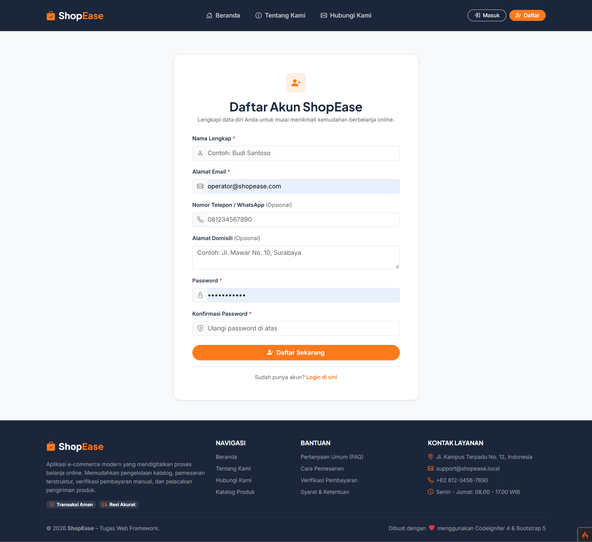
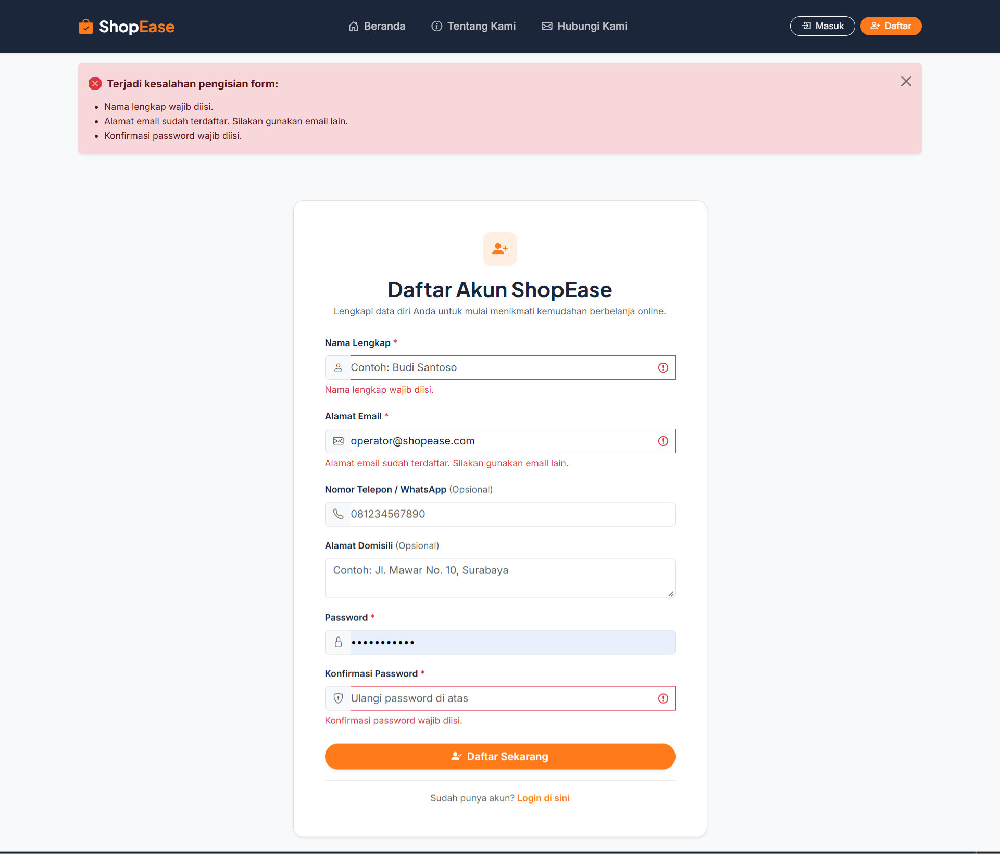
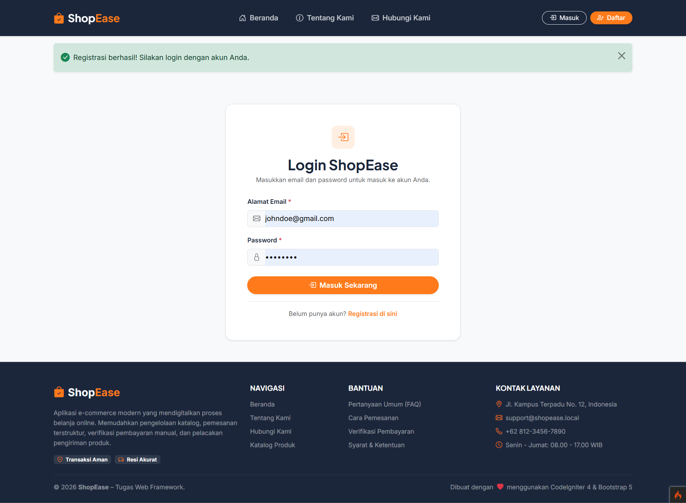
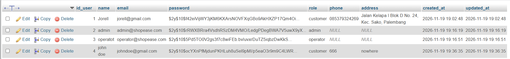
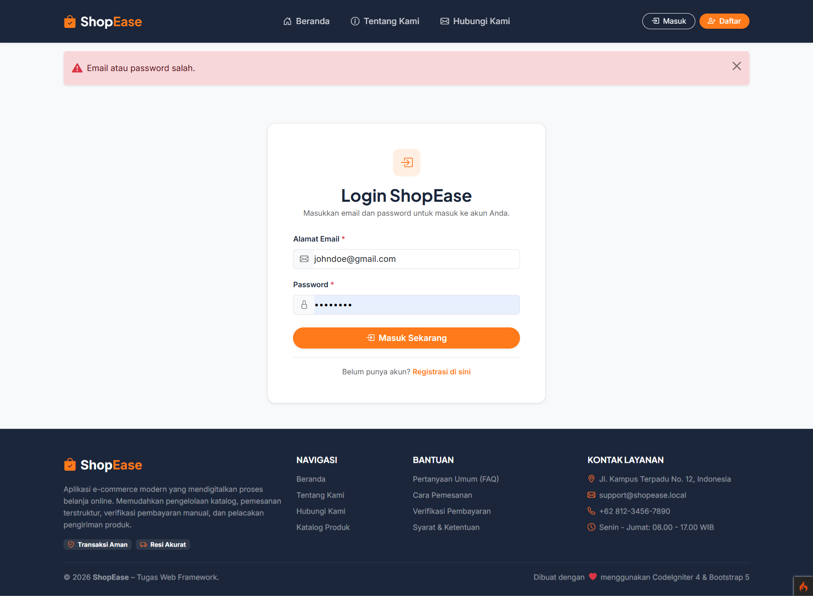
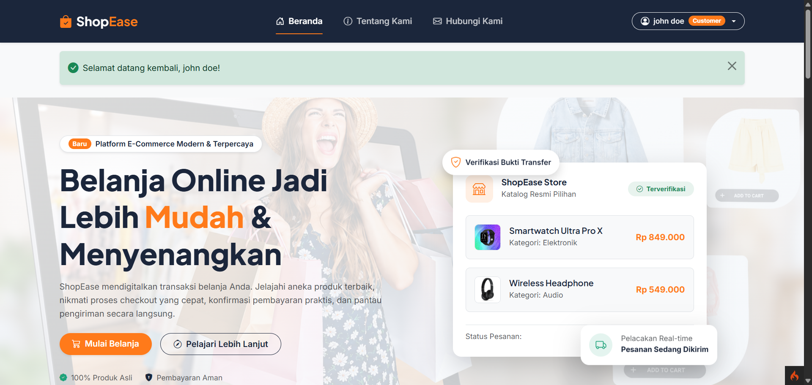
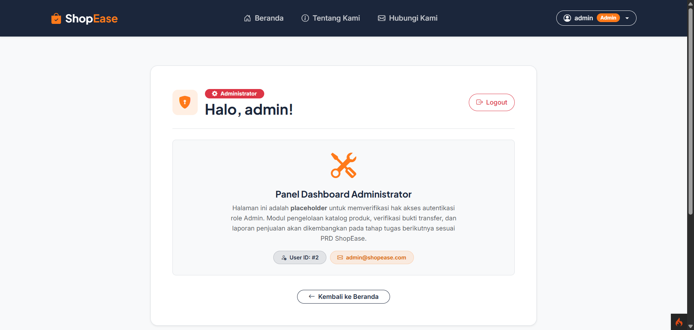
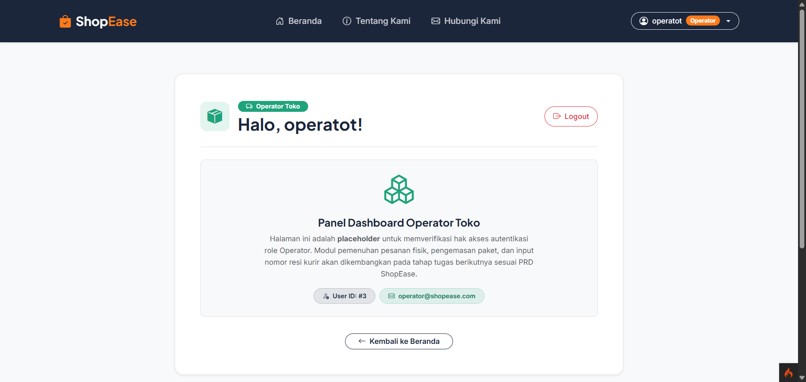
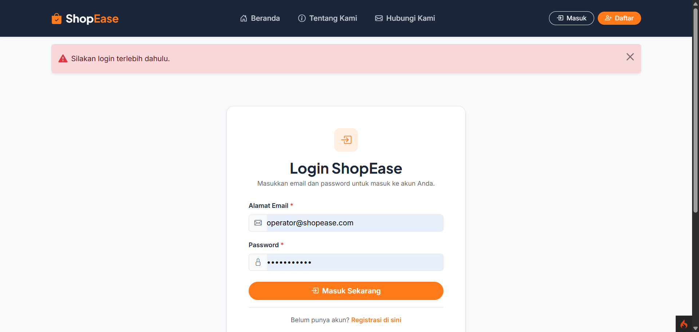

# Laporan Tugas: Authentication System ShopEase

| | |
|---|---|
| **Nama** | Jorell Ramos Sinaga |
| **NRP** | 5025241202 |
| **Mata Kuliah** | Pemrograman Berbasis Kerangka Kerja |
| **Kelas** | D |

---

## Daftar Isi
1. [Pendahuluan](#1-pendahuluan)
2. [Ringkasan yang Dikerjakan](#2-ringkasan-yang-dikerjakan)
3. [Teknologi & Prasyarat](#3-teknologi--prasyarat)
4. [Langkah Pembuatan](#4-langkah-pembuatan)
5. [Penjelasan Kode Penting](#5-penjelasan-kode-penting)
6. [Cara Menjalankan Proyek](#6-cara-menjalankan-proyek)
7. [Hasil Tampilan & Pengujian (Screenshot)](#7-hasil-tampilan--pengujian-screenshot)
8. [Tabel Skenario Pengujian](#8-tabel-skenario-pengujian)
9. [Checklist Keberhasilan](#9-checklist-keberhasilan)
10. [Kendala & Solusi](#10-kendala--solusi)
11. [Catatan Keamanan & Pengembangan Lanjutan](#11-catatan-keamanan--pengembangan-lanjutan)
12. [Referensi](#12-referensi)

---

## 1. Pendahuluan

### 1.1 Latar Belakang
Pada aplikasi e-commerce toko online **ShopEase**, sistem autentikasi dan otorisasi merupakan fondasi utama untuk mengamankan data pengguna dan membatasi akses fitur sesuai peran. Berdasarkan Product Requirement Document (PRD) ShopEase, modul autentikasi mencakup:
* **FR-001**: Pendaftaran akun baru bagi customer (*Registrasi*).
* **FR-002**: Otentikasi masuk sistem (*Login*) menggunakan email dan password yang terenkripsi.
* **FR-003**: Pengelolaan sesi pengguna (*Session Management*) dan keluar sistem (*Logout*).
* **FR-004**: Pembatasan hak akses berbasis peran (*Role-Based Access Control*) yang memisahkan area kerja Customer, Administrator, dan Operator Toko.

### 1.2 Tujuan Tugas
Tujuan dari pengerjaan modul ini adalah membangun sistem autentikasi yang aman dan terstruktur pada proyek ShopEase yang sudah ada menggunakan framework **CodeIgniter 4** dan basis data **MySQL**. Mahasiswa mempraktikkan:
1. Pembuatan skema database dan pemodelan data via `UserModel`.
2. Penerapan mekanisme validasi server-side dan enkripsi kata sandi menggunakan fungsi hashing standar industri (`password_hash` dan `password_verify`).
3. Pengelolaan session login dengan regenerasi Session ID untuk mencegah serangan *Session Fixation*.
4. Pembatasan akses halaman berbasis route filter menggunakan `AuthFilter`.
5. Integrasi antarmuka form autentikasi ke dalam layout responsif ShopEase yang telah dibangun sebelumnya.

### 1.3 Lingkup Pengerjaan
Lingkup tugas meliputi pembuatan tabel `users`, implementasi `UserModel`, `AuthController` (register, login, logout), `AuthFilter`, penyesuaian navigasi navbar dinamis, serta penyediaan dashboard placeholder untuk role `admin` dan `operator`. Fitur tingkat lanjut seperti reset password mandiri, keranjang belanja riil, dan verifikasi email berada di luar lingkup modul ini.

---

## 2. Ringkasan yang Dikerjakan

### Tabel Berkas yang Dibuat dan Diubah

| Berkas | Status | Fungsi |
|---|---|---|
| `database/db_shopease.sql` | Baru | Skrip DDL pembuatan database `db_shopease` dan tabel `users`. |
| `app/Models/UserModel.php` | Baru | Model CI4 untuk mengelola operasi CRUD tabel `users`, timestamps, dan allowed fields. |
| `app/Controllers/AuthController.php` | Baru | Mengelola logika registrasi, hashing password, otentikasi login, session, dan logout. |
| `app/Controllers/Admin/DashboardController.php` | Baru | Controller placeholder area panel Administrator. |
| `app/Controllers/Operator/DashboardController.php` | Baru | Controller placeholder area panel Operator Toko. |
| `app/Filters/AuthFilter.php` | Baru | Filter keamanan HTTP untuk memeriksa status login dan kesesuaian role pengguna. |
| `app/Config/Filters.php` | Diubah | Mendaftarkan alias filter `'auth' => \App\Filters\AuthFilter::class`. |
| `app/Config/Routes.php` | Diubah | Mendaftarkan rute auth (`register`, `login`, `logout`) dan route group terproteksi (`admin`, `operator`). |
| `app/Views/auth/register.php` | Baru | Antarmuka formulir registrasi responsif terintegrasi dengan layout `main`. |
| `app/Views/auth/login.php` | Baru | Antarmuka formulir login pengguna terintegrasi dengan layout `main`. |
| `app/Views/admin/dashboard.php` | Baru | Tampilan dashboard placeholder untuk role Admin. |
| `app/Views/operator/dashboard.php` | Baru | Tampilan dashboard placeholder untuk role Operator. |
| `app/Views/partials/navbar.php` | Diubah | Navigasi dinamis: tombol Masuk/Daftar untuk tamu, dropdown profil & tombol logout POST untuk user login. |
| `app/Controllers/BaseController.php` | Diubah | Memastikan helper `url` dan `form` dimuat otomatis untuk seluruh controller. |

---

## 3. Teknologi & Prasyarat

* **Web Framework**: CodeIgniter 4 (PHP Framework MVC)
* **Bahasa Pemrograman**: PHP versi 8.1+
* **Basis Data**: MySQL (XAMPP default port 3306)
* **Frontend UI**: Bootstrap 5.3 CDN, Bootstrap Icons v1.11.3 CDN, Google Fonts (*Plus Jakarta Sans* & *Inter*)
* **Keamanan**: Algoritma Bcrypt/Argon2 (`PASSWORD_DEFAULT`), Session Regeneration, Filter CSRF bawaan CI4

---

## 4. Langkah Pembuatan

### Langkah 1: Pembuatan Database dan Tabel `users`
Membuat berkas `database/db_shopease.sql` yang memuat struktur tabel `users`:
```sql
CREATE DATABASE IF NOT EXISTS db_shopease;
USE db_shopease;

CREATE TABLE IF NOT EXISTS users (
    id_user INT AUTO_INCREMENT PRIMARY KEY,
    name VARCHAR(100) NOT NULL,
    email VARCHAR(100) NOT NULL UNIQUE,
    password VARCHAR(255) NOT NULL,
    role ENUM('customer', 'admin', 'operator') NOT NULL DEFAULT 'customer',
    phone VARCHAR(20) NULL,
    address TEXT NULL,
    created_at DATETIME NULL,
    updated_at DATETIME NULL
) ENGINE=InnoDB DEFAULT CHARSET=utf8mb4 COLLATE=utf8mb4_unicode_ci;
```

### Langkah 2: Konfigurasi Koneksi Database (`.env`)
Mengaktifkan driver MySQLi dan mengarahkan database ke `db_shopease` pada berkas `.env`:
```ini
CI_ENVIRONMENT = development

database.default.hostname = localhost
database.default.database = db_shopease
database.default.username = root
database.default.password =
database.default.DBDriver = MySQLi
database.default.port = 3306
```

### Langkah 3: Membuat `UserModel`
Membuat `app/Models/UserModel.php` untuk mengatur primary key `id_user`, allowed fields, dan manajemen timestamps otomatis (`created_at`, `updated_at`).

### Langkah 4: Membuat `AuthController`
Menyiapkan logika pendaftaran dan login:
* `register()` & `store()`: Validasi form lengkap, hashing password menggunakan `password_hash()`, serta pemaksaan role `'customer'`.
* `login()` & `authenticate()`: Memverifikasi email dan password via `password_verify()`, regenerasi session ID dengan `session()->regenerate(true)`, dan penyimpanan session aman.
* `logout()`: Menghancurkan session via `session()->destroy()` dan menginisialisasi session baru untuk membawa flash message sukses.

### Langkah 5: Mendefinisikan Rute Autentikasi (`Routes.php`)
Menambahkan pemetaan rute baru tanpa mengganggu rute landing page lama:
```php
$routes->get('register', 'AuthController::register', ['as' => 'register']);
$routes->post('register', 'AuthController::store', ['as' => 'register.store']);
$routes->get('login', 'AuthController::login', ['as' => 'login']);
$routes->post('login', 'AuthController::authenticate', ['as' => 'login.authenticate']);
$routes->post('logout', 'AuthController::logout', ['as' => 'logout']);
```

### Langkah 6: Membuat View Registrasi dan Login
Merancang `app/Views/auth/register.php` dan `app/Views/auth/login.php` yang mewarisi layout utama `layouts/main.php`, memanfaatkan komponen input group berikon, proteksi CSRF, serta penanganan error field via `is-invalid` dan `invalid-feedback`.

### Langkah 7: Pengaktifan Helper dan Proteksi CSRF
Memastikan helper `url` dan `form` dideklarasikan pada properti `$helpers` di `BaseController.php` dan memastikan filter `csrf` aktif pada `$globals['before']` di `app/Config/Filters.php`.

### Langkah 8: Membuat dan Mendaftarkan `AuthFilter`
Membuat `app/Filters/AuthFilter.php` untuk memvalidasi sesi `isLoggedIn` dan mencocokkan argumen peran pengguna (`$arguments`). Mendaftarkannya di `app/Config/Filters.php`:
```php
public array $aliases = [
    'csrf' => CSRF::class,
    'auth' => \App\Filters\AuthFilter::class,
    ...
];
```

### Langkah 9: Mengamankan Rute Dashboard Role
Mengelompokkan rute panel admin dan operator dengan filter otorisasi:
```php
$routes->group('admin', ['filter' => 'auth:admin'], static function ($routes) {
    $routes->get('/', 'Admin\DashboardController::index', ['as' => 'admin.dashboard']);
});
$routes->group('operator', ['filter' => 'auth:operator'], static function ($routes) {
    $routes->get('/', 'Operator\DashboardController::index', ['as' => 'operator.dashboard']);
});
```

### Langkah 10: Membuat Dashboard Placeholder
Membuat controller dan tampilan `app/Views/admin/dashboard.php` serta `app/Views/operator/dashboard.php` agar pengalihan hak akses role tidak menghasilkan error 404.

### Langkah 11: Memperbarui Navbar Menjadi Dinamis
Memodifikasi `app/Views/partials/navbar.php` agar mengenali status `session('isLoggedIn')`. Jika belum login, tombol *Masuk* dan *Daftar* ditampilkan. Jika sudah login, sistem menampilkan dropdown profil pengguna, link dashboard khusus admin/operator, dan tombol logout form POST.

---

## 5. Penjelasan Kode Penting

### 5.1 Alur MVC dan Keamanan Autentikasi
Alur request berjalan terstruktur:
$$\text{HTTP Request} \longrightarrow \text{Routes} \longrightarrow \text{AuthFilter} \longrightarrow \text{AuthController} \longrightarrow \text{UserModel} \longrightarrow \text{View}$$
Setiap permintaan ke rute terproteksi disaring terlebih dahulu oleh `AuthFilter` sebelum controller dieksekusi.

### 5.2 Hashing Password (`password_hash` vs `password_verify`)
Kata sandi tidak pernah disimpan dalam format teks polos (*plaintext*) demi mematuhi standar privasi OWASP:
* **Saat Registrasi**: Password dienkripsi menggunakan fungsi bawaan PHP:
  ```php
  $password = password_hash($this->request->getPost('password'), PASSWORD_DEFAULT);
  ```
  Fungsi ini otomatis menambahkan *salt* acak dan menghasilkan hash 60 karakter yang aman terhadap serangan *rainbow table*.
* **Saat Login**: Hash diuji keasliannya tanpa mendekripsi hash tersebut:
  ```php
  if (! $user || ! password_verify($password, $user['password'])) {
      return redirect()->back()->withInput()->with('error', 'Email atau password salah.');
  }
  ```

### 5.3 Validasi Unik dan Pemaksaan Role di Server
* Aturan `is_unique[users.email]` mencegah pendaftaran akun ganda dengan alamat email yang sama.
* Untuk mencegah manipulasi request (misal injeksi parameter `role=admin` lewat form atau tools inspeksi HTTP), controller secara eksplisit memaksa role akun pendaftar baru menjadi `'customer'`:
  ```php
  $userData['role'] = 'customer';
  ```

### 5.4 Pencegahan Session Fixation & Keamanan Data Session
Saat kredensial login terbukti valid, sistem mengeksekusi:
```php
session()->regenerate(true);
```
Fungsi ini mengganti ID sesi yang lama dengan ID sesi baru dan menghapus data sesi lama di server. Informasi yang disimpan ke session dibatasi hanya data identitas dasar (`user_id`, `name`, `email`, `role`, dan flag `isLoggedIn`), tanpa menyertakan password maupun hash password.

### 5.5 Pesan Kesalahan Login yang Generik
Jika email tidak ditemukan atau password salah, controller mengembalikan pesan yang seragam: *"Email atau password salah."* Hal ini mencegah teknik *User Enumeration*, di mana penyerang mencoba menebak alamat email mana saja yang telah terdaftar pada sistem.

### 5.6 Mekanisme Filter Hak Akses (`AuthFilter`)
Pada `AuthFilter::before()`, terdapat dua lapisan pengecekan:
1. **Pemeriksaan Sesi**: Bila pengguna belum login, langsung dialihkan ke `/login` dengan notifikasi error.
2. **Pemeriksaan Otorisasi Role**:
   ```php
   if (! empty($arguments)) {
       $userRole = session()->get('role');
       if (! in_array($userRole, $arguments, true)) {
           return redirect()->to('/');
       }
   }
   ```
   Rute dengan filter `'auth:admin'` hanya akan meloloskan user dengan role `admin`. Jika role adalah `customer`, user dialihkan ke halaman utama tanpa error crash.

### 5.7 Tombol Logout Menggunakan Form POST & CSRF
Tautan logout tidak menggunakan link biasa (`<a href="...">`) bermetode GET, melainkan form POST dengan token CSRF:
```html
<form action="<?= base_url('logout') ?>" method="post">
    <?= csrf_field() ?>
    <button type="submit" class="dropdown-item text-danger">Logout</button>
</form>
```
Hal ini mencegah serangan *Cross-Site Request Forgery* (CSRF) di mana penyerang memicu logout paksa pengguna melalui penyematan tag gambar (``) di situs eksternal.

---

## 6. Cara Menjalankan Proyek

1. **Impor Database**:
   Buka phpMyAdmin (`http://localhost/phpmyadmin`), buat database baru bernama `db_shopease`, lalu impor berkas `database/db_shopease.sql`.
2. **Konfigurasi `.env`**:
   Pastikan pengaturan koneksi database di `.env` sudah sesuai (user `root`, password kosong, database `db_shopease`).
3. **Menjalankan Server**:
   Jalankan perintah berikut di terminal root proyek:
   ```bash
   php spark serve
   ```
4. **Mengakses Halaman**:
   * Halaman Registrasi: `http://localhost:8080/register`
   * Halaman Login: `http://localhost:8080/login`
5. **Menyiapkan Akun Admin & Operator Uji**:
   Daftarkan akun melalui form registrasi di web, kemudian ubah perannya melalui tab SQL phpMyAdmin:
   ```sql
   UPDATE users SET role = 'admin' WHERE email = 'admin@shopease.com';
   UPDATE users SET role = 'operator' WHERE email = 'operator@shopease.com';
   ```

---

## 7. Hasil Tampilan & Pengujian (Screenshot)

> *Catatan: Letakkan tangkapan layar pengujian asli Anda di dalam folder `docs/screenshots/` dengan nama berkas yang sesuai di bawah ini.*

### 7.1 Formulir Registrasi
Tampilan halaman registrasi akun baru dengan formulir data lengkap dan validasi input.

<!-- Ganti dengan screenshot asli -->

### 7.2 Validasi Error Registrasi
Tampilan pesan error validasi ketika isian formulir dikosongkan atau format tidak valid.

<!-- Ganti dengan screenshot asli -->

### 7.3 Registrasi Berhasil
Tampilan halaman login dengan alert hijau setelah proses registrasi akun baru sukses.

<!-- Ganti dengan screenshot asli -->

### 7.4 Data Password Ter-Hash di Database
Tampilan tabel `users` pada phpMyAdmin yang membuktikan kata sandi tersimpan dalam bentuk hash bcrypt/argon.

<!-- Ganti dengan screenshot asli -->

### 7.5 Pengujian Login Gagal
Tampilan pesan peringatan error saat pengguna memasukkan email atau password yang salah.

<!-- Ganti dengan screenshot asli -->

### 7.6 Login Berhasil (Role Customer)
Tampilan Beranda setelah customer berhasil login, dengan navbar menampilkan nama pengguna dan badge role.

<!-- Ganti dengan screenshot asli -->

### 7.7 Dashboard Administrator
Tampilan panel dashboard khusus untuk pengguna dengan hak akses role Admin.

<!-- Ganti dengan screenshot asli -->

### 7.8 Dashboard Operator Toko
Tampilan panel dashboard khusus untuk pengguna dengan hak akses role Operator.

<!-- Ganti dengan screenshot asli -->

### 7.9 Akses Halaman Terlindungi Tanpa Login
Tampilan pengalihan otomatis ke halaman login ketika membuka rute terproteksi tanpa sesi aktif.

<!-- Ganti dengan screenshot asli -->

